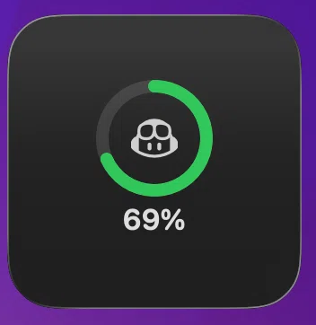
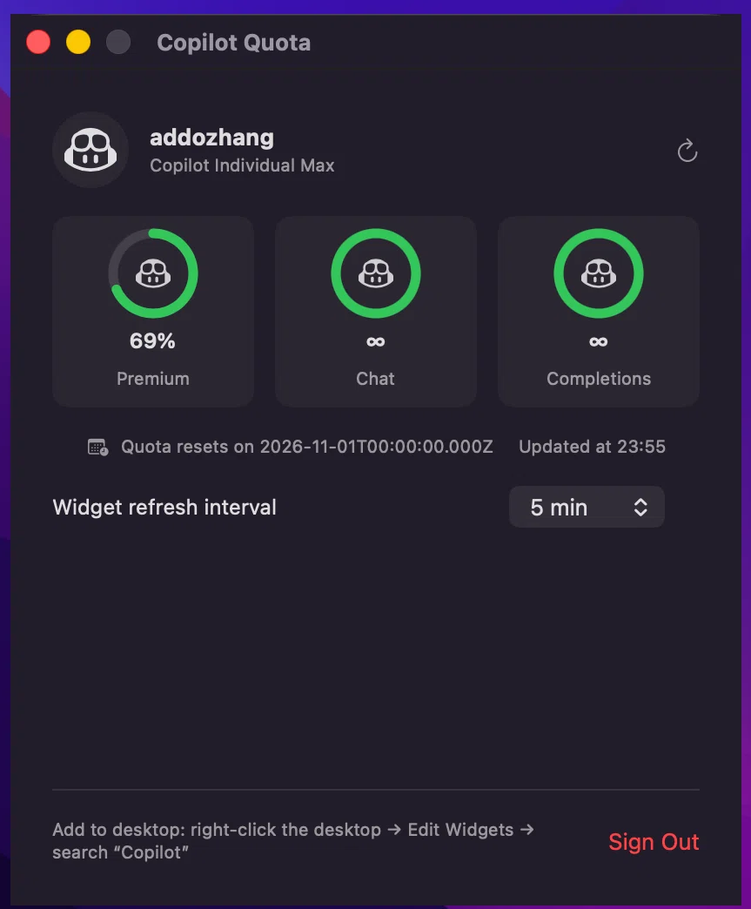

# Copilot Quota

English | **[简体中文](README.zh-CN.md)**

A macOS desktop widget (WidgetKit) that shows your remaining GitHub Copilot quota —
battery-widget style: a ring, the Copilot glyph, and a percentage.

| Desktop widget | App |
| :---: | :---: |
|  |  |

## Install

Download and unzip [the latest release](https://github.com/addozhang/CopilotQuota/releases/latest),
drag `Copilot Quota.app` into **/Applications**, then allow Gatekeeper once:

```bash
xattr -dr com.apple.quarantine "/Applications/Copilot Quota.app"
```

(Or: System Settings → Privacy & Security → **Open Anyway**.)
Requires macOS 14+ · universal (Apple Silicon & Intel).

## Usage

1. Open **Copilot Quota** → sign in with GitHub (OAuth device flow).
2. Right-click the desktop → Edit Widgets → add **Copilot**.

Clicking the widget opens the app, where you can also pick the refresh interval
(5 / 10 / 30 / 60 min).

## Build from source

Open `CopilotQuota.xcodeproj` and run (`⌘R`), or:

```bash
xcodebuild -project CopilotQuota.xcodeproj -target CopilotQuota -configuration Release build SYMROOT=build
```

## Release

```bash
./scripts/release.sh
```

Builds a universal Release app, signs it with the **Developer ID Application**
certificate when one is available (ad-hoc otherwise), submits it to Apple
notarization when the `solocraft-notary` keychain profile exists (see the
script header for one-time setup), staples the ticket, and produces
`build/CopilotQuota-<version>.zip` + `.dmg`.

## Notes

- Quota comes from `api.github.com/copilot_internal/user`
  (premium → chat → completions), fetched with the token from the device flow.
- The token (scope `read:user`) never leaves this machine. Widget refreshes are
  capped by the system's daily widget budget, so the chosen interval is a lower bound.
- The widget extension is sandboxed; data and tokens are shared through a
  preference-domain read-write exception, so the widget can rotate the ~8h
  OAuth token itself while the app is closed — fine for personal use and
  Developer ID distribution, not App Store ready (the store rejects
  temporary-exception entitlements).
- Sign out / refresh live in the app. UI is English + 简体中文, follows the system language.
- The Copilot glyph is based on GitHub [Octicons](https://github.com/primer/octicons) (MIT).
