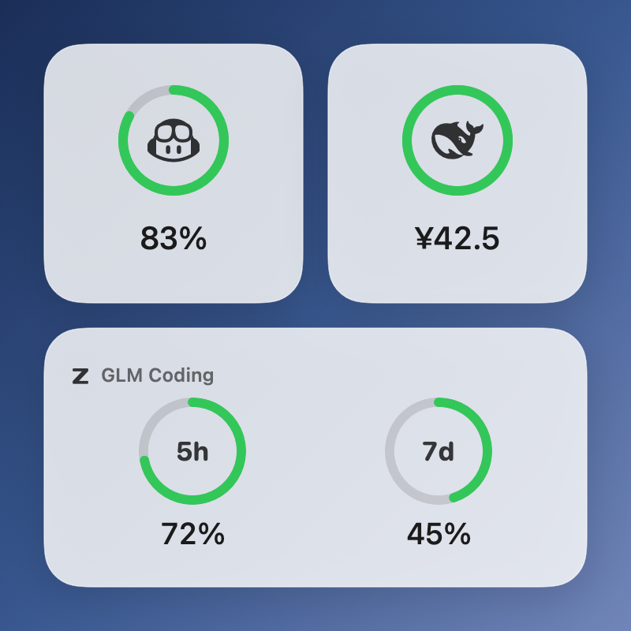
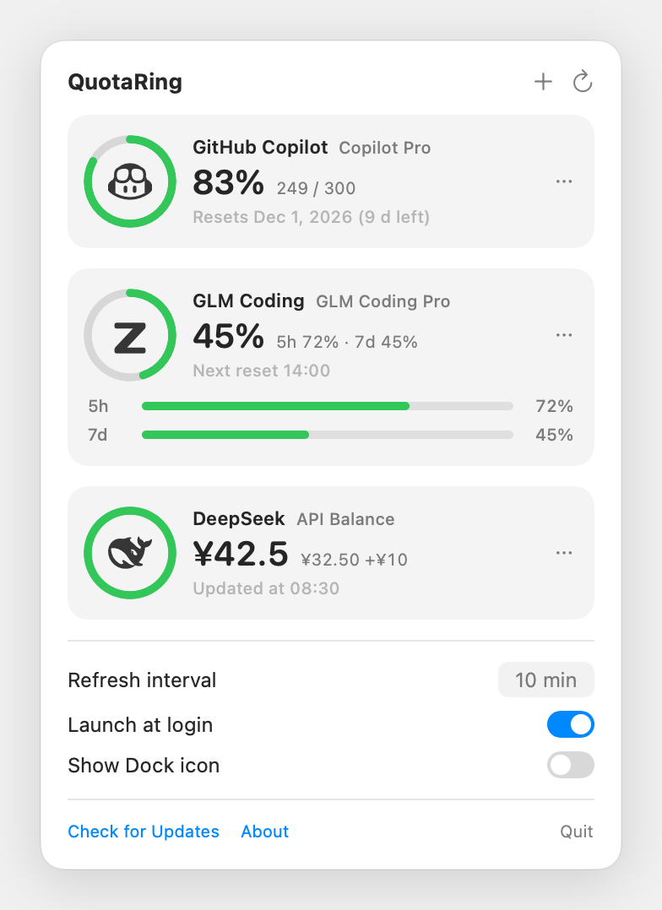

# Copilot Quota

English | **[简体中文](README.zh-CN.md)**

**[Website](https://solocraft.app/copilot-quota) · [Download DMG](https://github.com/addozhang/CopilotQuota/releases/latest)**

A macOS menu bar app and desktop widget (WidgetKit) that shows your remaining
GitHub Copilot quota — battery-widget style: a ring, the Copilot glyph, and a percentage.

| Desktop widget | App |
| :---: | :---: |
|  |  |

## Install

### Download DMG

Download [the latest release](https://github.com/addozhang/CopilotQuota/releases/latest)
(DMG), open it and drag `Copilot Quota.app` into **/Applications** — the app is
signed with a **Developer ID certificate and notarized by Apple**, so
Gatekeeper lets it through on first launch. No workarounds needed.

### Homebrew

```bash
brew tap addozhang/copilot-quota https://github.com/addozhang/CopilotQuota
brew install --cask copilot-quota
```

You can verify the signature yourself:

```bash
spctl -a -t exec -vv "/Applications/Copilot Quota.app"
# → accepted, source=Notarized Developer ID
```

Requires macOS 14+ · universal (Apple Silicon & Intel).

## Usage

1. Open **Copilot Quota** → sign in with GitHub (OAuth device flow).
2. Right-click the desktop → Edit Widgets → add **Copilot**.

By default, **Copilot Quota** runs in pure Menu Bar mode (no Dock icon), showing
the Copilot icon and remaining percentage in the menu bar. Click the menu bar
icon (or the desktop widget) to view remaining requests, reset countdown,
refresh interval (5 / 10 / 30 / 60 min), Launch at Login, Dock icon visibility,
and built-in update checks.

## Build & Test

Open `CopilotQuota.xcodeproj` and run (`⌘R`), or:

```bash
# Build Release
xcodebuild -project CopilotQuota.xcodeproj -scheme CopilotQuota -configuration Release build

# Run unit tests
xcodebuild -project CopilotQuota.xcodeproj -scheme CopilotQuota -configuration Debug test
```

## Release

```bash
./scripts/release.sh
```

Builds a universal Release app, signs it with the **Developer ID Application**
certificate when one is available (ad-hoc otherwise), submits it to Apple
notarization when the `solocraft-notary` keychain profile exists (see the
script header for one-time setup), staples the ticket, updates
`Casks/copilot-quota.rb` with the new version and SHA256, and produces
`build/CopilotQuota-<version>.zip`, `.dmg`, and `.sha256`.

Pushing a `v*` tag also triggers `.github/workflows/release.yml` to run tests,
build, optionally sign & notarize via repository secrets, and publish a GitHub Release.

## Notes

- Quota comes from `api.github.com/copilot_internal/user`
  (preferring metered `premium_interactions`, falling back to `chat` / `completions`
  when needed), fetched with the token from the device flow.
- OAuth credentials (scope `read:user`) are stored atomically in the **macOS Keychain**
  (existing plaintext `UserDefaults` tokens from earlier versions are migrated
  automatically and scrubbed on first launch).
- The widget extension is sandboxed; cached quota and preferences are shared
  through a preference-domain read-write exception, and Keychain access is
  shared via ACL so the widget can still rotate the ~8h OAuth token while the
  app is closed — fine for personal use and Developer ID distribution, not App
  Store ready.
- UI is English + 简体中文, following the system language.
- The Copilot glyph is based on GitHub [Octicons](https://github.com/primer/octicons) (MIT).
