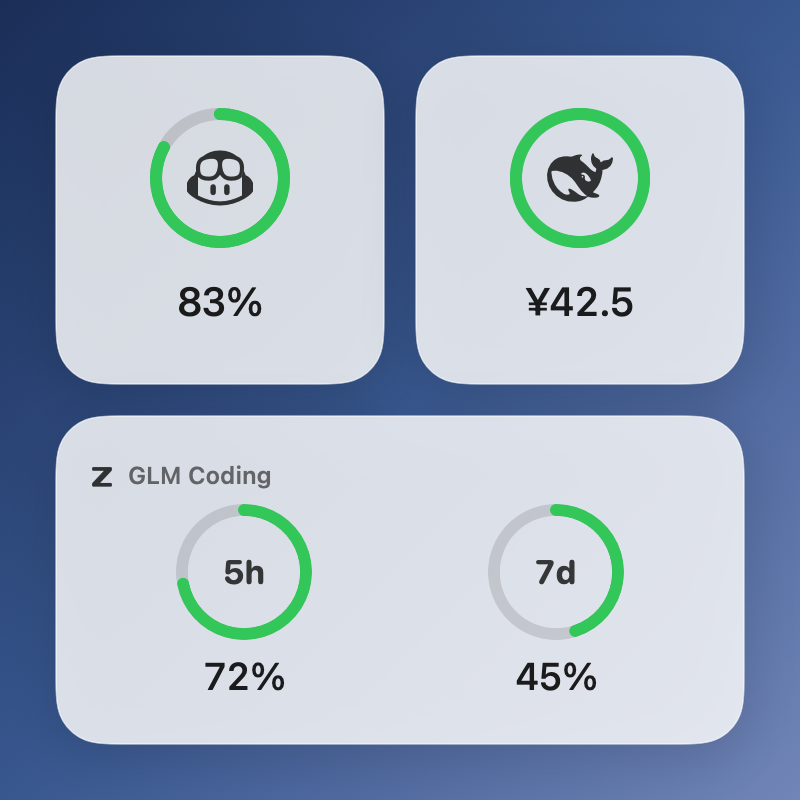
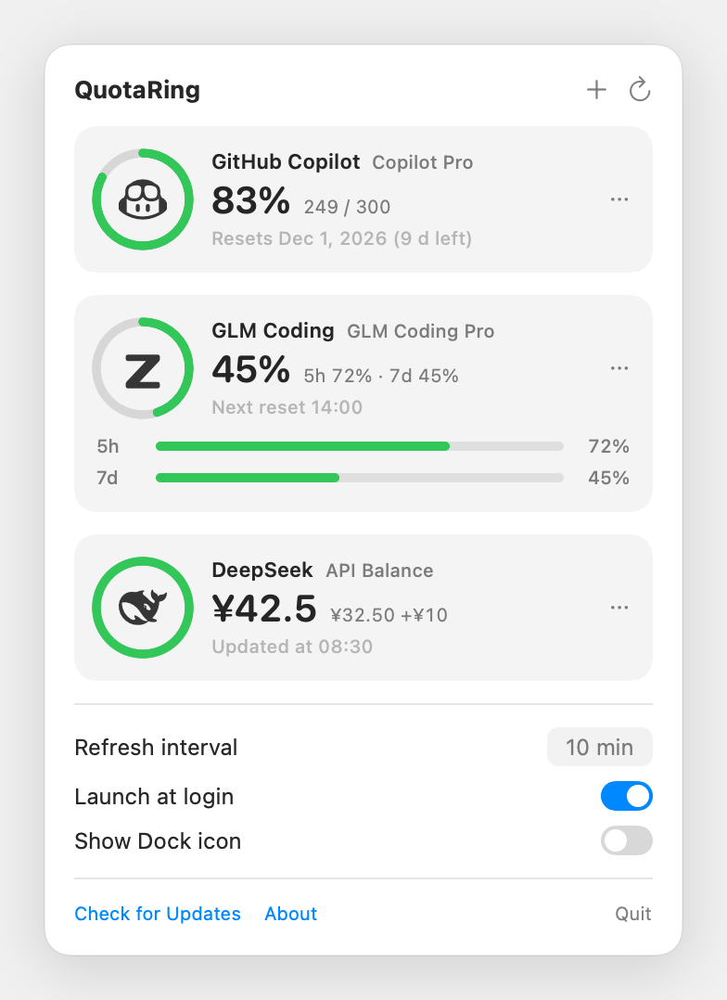

# Copilot Quota

**[English](README.md)** | 简体中文

**[官网](https://solocraft.app/copilot-quota) · [下载 DMG](https://github.com/addozhang/CopilotQuota/releases/latest)**

仿系统电池样式的 macOS 菜单栏应用与桌面小组件（WidgetKit）：一个圆环 + Copilot 图标 + 剩余百分比。

| 桌面小组件 | App |
| :---: | :---: |
|  |  |

## 安装

### 下载 DMG

下载 [最新版本](https://github.com/addozhang/CopilotQuota/releases/latest) 的 DMG，
打开并把 `Copilot Quota.app` 拖入「应用程序」——App 已使用 **Developer ID
证书签名并通过 Apple 公证**，首次打开无需任何 Gatekeeper 放行操作。

### Homebrew

```bash
brew tap addozhang/copilot-quota https://github.com/addozhang/CopilotQuota
brew install --cask copilot-quota
```

可自行校验签名：

```bash
spctl -a -t exec -vv "/Applications/Copilot Quota.app"
# → accepted, source=Notarized Developer ID
```

需要 macOS 14+ · Universal 双架构（Apple Silicon 和 Intel）。

## 使用

1. 打开 **Copilot Quota** → 用 GitHub 登录（OAuth 设备授权流程）。
2. 右键桌面 → 编辑小组件 → 添加 **Copilot**。

默认以**纯菜单栏模式**运行（隐藏 Dock 图标），在菜单栏常驻展示 Copilot 图标与剩余百分比。
点击菜单栏图标或桌面小组件即可查看剩余次数、重置倒计时、调整刷新间隔（5 / 10 / 30 / 60 分钟）、
开启开机自启、切换是否显示 Dock 图标以及检查更新。

## 从源码构建与测试

用 Xcode 打开 `CopilotQuota.xcodeproj`，`⌘R` 运行；或：

```bash
# 构建 Release
xcodebuild -project CopilotQuota.xcodeproj -scheme CopilotQuota -configuration Release build

# 运行单元测试
xcodebuild -project CopilotQuota.xcodeproj -scheme CopilotQuota -configuration Debug test
```

## 发布

```bash
./scripts/release.sh
```

构建 universal Release 产物：检测到 **Developer ID Application** 证书则正式
签名（否则 ad-hoc），存在 `solocraft-notary` keychain profile 时自动提交
Apple 公证并装订票据（一次性配置见脚本头部说明），自动同步更新
`Casks/copilot-quota.rb` 中的版本号与 SHA256，产出
`build/CopilotQuota-<版本>.zip`、`.dmg` 与 `.sha256`。

推送 `v*` 标签也会自动触发 `.github/workflows/release.yml` 运行测试、构建打包并创建 GitHub Release。

## 说明

- 配额来自 `api.github.com/copilot_internal/user`（优先展示计量中的 `premium_interactions`，必要时回退到 `chat` / `completions`），用设备流程拿到的 token 拉取。
- OAuth 凭证（scope 仅 `read:user`）原子存储在 **macOS Keychain** 中（老版本存于 `UserDefaults` 的明文 token 会在首次启动时自动迁移并清除）。
- widget 扩展已沙盒化，缓存与偏好通过偏好域读写例外共享，Keychain 通过 ACL 共享，App 未运行时 widget 仍可自行轮换约 8 小时寿命的 OAuth token——个人使用 / Developer ID 分发没问题；上架 Mac App Store 需改为 App Group 方案。
- 界面支持英文和简体中文，跟随系统语言。
- Copilot 图标基于 GitHub [Octicons](https://github.com/primer/octicons)（MIT）。
